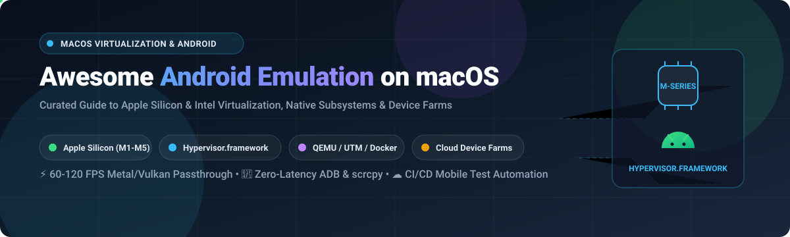

# Awesome Virtualization & Android Emulation on macOS 🍏🤖⚡

<p align="center">
  
</p>

<p align="center">
  <strong>Curated Directory of Cloud Device Farms, Commercial Subsystems & Open-Source Android Emulation Platforms on macOS</strong>
</p>

<p align="center">
  <a href="https://github.com/ishandutta2007/Awesome-Virtualization-Android-Emulation-On-Macos"></a>
  <a href="https://github.com/sindresorhus/awesome"></a>
  <a href="https://github.com/ishandutta2007/Awesome-Virtualization-Android-Emulation-On-Macos/stargazers"></a>
  <a href="https://github.com/ishandutta2007/Awesome-Virtualization-Android-Emulation-On-Macos/network/members"></a>
  <a href="https://github.com/ishandutta2007/Awesome-Virtualization-Android-Emulation-On-Macos/blob/main/LICENSE"></a>
</p>

---

## 🧭 Table of Contents
- [📌 Overview & Scope](#-overview--scope)
- [📈 Sector Overview & Market Dynamics](#-sector-overview--market-dynamics)
- [☁️ SaaS & Hosted Platforms](#️-saas--hosted-platforms)
- [💻 Open-Source GitHub Projects](#-open-source-github-projects)
- [🛠️ Architecture & Under the Hood](#️-architecture--under-the-hood)
- [🤝 How to Contribute](#-how-to-contribute)
- [⚖️ Disclaimer](#️-disclaimer)

---

## 📌 Overview & Scope

Running Android environments on Apple hardware has evolved dramatically with the transition to **Apple Silicon (M1/M2/M3/M4/M5)** and modern macOS releases (macOS Sonoma, Sequoia, and beyond). Developers and QA teams no longer rely on sluggish, translation-heavy x86 emulators. Instead, today's macOS Android virtualization ecosystem leverages:

1. ⚡ **Native ARM-on-ARM Execution**: Direct hypervisor virtualization using Apple's `Hypervisor.framework` (`hvf`) and `Virtualization.framework` (`VZ`).
2. 🎮 **Metal & Vulkan Hardware Acceleration**: Near-native graphics performance translating Android GLES/Vulkan calls to Apple Metal.
3. 🐳 **Containerized & Headless Micro-VMs**: Running lightweight Android-in-Docker or Redroid instances inside Lima or Colima Linux microVMs.
4. 📱 **High-Throughput Device Streaming**: Ultra-low-latency display mirroring via `scrcpy`, WebSockets, and WebCodecs at 60–120 FPS.
5. ☁️ **Enterprise Cloud Device Farms**: Scalable browser-based real devices and simulated clusters for CI/CD Appium and Espresso regression testing.

---

## 📈 Sector Overview & Market Dynamics

The global mobile application testing and virtualization market is valued at approximately **$7.8 Billion in 2026** and is projected to surpass **$15.2 Billion by 2032**, expanding at a Compound Annual Growth Rate (CAGR) of **~11.8%**. 

This sector exhibits a **moderately fragmented market structure** characterized by a dual-tier competitive landscape:
- **Enterprise Infrastructure & Testing Farms**: Moderately concentrated, dominated by established hyperscalers and testing clouds (**AWS Device Farm**, **Google Firebase Test Lab**, **BrowserStack**, and **Sauce Labs**). These players maintain robust moats through extensive physical device racks, automated enterprise CI/CD compliance, and carrier network simulation.
- **Desktop Virtualization & Specialized Gaming Engines**: Highly dynamic and segmented. Consumer and gaming virtualization features prominent vendors (**BlueStacks**, **MuMuPlayer Pro / NetEase**, **NoxPlayer**) competing directly against deeply integrated developer-first utilities (**Android Studio Emulator**, **Corellium Arm Virtualization**) and community-driven hypervisor runtimes (**UTM**, **Waydroid**, **Redroid**, and **scrcpy**).

---

## ☁️ SaaS & Hosted Platforms

The following SaaS, cloud device farm, and commercial hosted emulation platforms enable Android virtualization, cloud streaming, automated mobile DevOps, and debugging directly from macOS environments. Sorted by company size, valuation, and enterprise scale (descending):

| Platform / Vendor | Description | Company Size (Valuation / Revenue) | Pricing (Starting Tier) | Free Tier / Trial Limits |
| :--- | :--- | :--- | :--- | :--- |
| **[AWS Device Farm](https://aws.amazon.com/device-farm/)** | Managed cloud testing service running Android tests concurrently on real physical devices hosted in AWS data centers. | **$2.3+ Trillion Market Cap** (Amazon / AWS Cloud division with $105B+ annual run rate) | **$0.17 per device minute** (Pay-as-you-go) or **$250/month per unmetered slot** | **1,000 free device minutes** one-time trial on initial AWS account signup |
| **[Firebase Test Lab](https://firebase.google.com/docs/test-lab)** | Google Cloud mobile testing infrastructure executing automated Robo tests and Espresso suites across physical and virtual Android devices. | **$2.1+ Trillion Market Cap** (Alphabet Inc. / Google Cloud) | **$1.00 per virtual device hour** & **$5.00 per physical device hour** (Blaze pay-as-you-go plan) | **Spark Plan (Free forever)**: **10 virtual device tests/day** + **5 physical device tests/day** |
| **[BrowserStack App Live & Automate](https://www.browserstack.com/)** | Cloud-based mobile device testing cloud supporting manual exploratory testing and Appium test execution across 3,000+ real Android devices. | **$4.0 Billion Valuation** ($200M+ ARR, bootstrapped market leader) | **$29/month** (App Live billed annually) or **$199/month** (App Automate for automated mobile testing) | **Free trial**: **30 minutes of interactive manual testing** & **100 automated test minutes** |
| **[Sauce Labs Mobile Testing](https://saucelabs.com/)** | Continuous cloud mobile testing platform offering automated and live testing across public and private Android real devices and emulators. | **$1.5+ Billion Valuation** ($150M+ ARR, backed by TPG and Riverwood) | **$199/month** (Starting plan billed annually for 1 concurrent real-device test slot) | **28-day free trial** with access to **300 minutes of automated device testing** |
| **[LambdaTest](https://www.lambdatest.com/)** | AI-augmented test execution cloud providing real Android devices and virtual emulators with geolocation testing and network throttling. | **$350 Million Valuation** (~$50M+ ARR, backed by PremjiInvest) | **$25/month** (Real Device App Testing billed annually) or **$15/month** (Virtual cloud testing) | **Free forever plan**: **60 minutes/month of live browser/app testing** (in 10-minute session blocks) |
| **[Corellium](https://www.corellium.com/)** | Cloud-native ARM-based hypervisor platform providing pure virtualized Android and iOS models for mobile firmware security analysis and DevSecOps. | **$150 Million Valuation** ($20M+ ARR, backed by Paladin Capital) | **$99/month per active virtual device core** (Starting Developer Tier) | **7-day guided enterprise proof-of-concept trial** upon sales request |
| **[BlueStacks Air / BlueStacks](https://www.bluestacks.com/)** | Commercial Android emulation player and cloud platform offering native Apple Silicon acceleration, Metal translation, and gamepad keymapping. | **$100 Million+ Estimated Valuation** (now part of now.gg, 500M+ global downloads) | **$0 (Ad-supported Free Desktop Player)** or **$9.99/month** (now.gg premium cloud gaming pass) | **Free forever desktop application** (unlimited usage supported by non-intrusive sponsor cards) |
| **[MuMuPlayer Pro (NetEase)](https://www.mumuplayer.com/mac/)** | Native Apple Silicon (M-Series) Android 12 emulator engineered by NetEase for macOS with high FPS, Metal rendering, and multi-window support. | **$60+ Billion Market Cap** (NetEase Inc., global gaming and technology enterprise) | **$4.99/month** or **$39.99/year** (Subscription for full Apple Silicon pro engine) | **7-day full-feature free trial** with unlimited session time and GPU acceleration |
| **[Genymotion Cloud & Desktop](https://www.genymotion.com/)** | Virtual Android device platform built for developers, QA engineers, and security researchers with custom ADB integration and REST APIs. | **$30 Million Estimated Valuation** (Genymobile SAS, Paris) | **$0.05 per device minute** (PaaS on AWS/GCP) or **$35/month** ($415/year per user for Desktop) | **30-day free trial** for Genymotion Desktop with full virtual sensor and ADB access |
| **[NoxPlayer (Mac Edition)](https://www.bignox.com/)** | Consumer Android virtualization container for macOS facilitating multi-instance execution, script automation, and APK sideloading. | **$25 Million Estimated Valuation** (Nox Digital Entertainment) | **$0 (Ad-supported Free Edition)** or **$3.69/month** (VIP ad-free subscription) | **Free forever base version** with unlimited emulation sessions and full multi-instance access |

---

## 💻 Open-Source GitHub Projects

The open-source community provides remarkable tools, ranging from native hypervisor wrappers and QEMU virtualizers to Android-in-Docker containers and low-latency ADB streamers.

> **Sorted by GitHub Stars (descending)** — Star counts are updated in real-time. Click any badge to view the repository stargazers!

| Repository / Project | Stars | Focus & macOS Relevance |
| :--- | :---: | :--- |
| **[scrcpy (Genymobile/scrcpy)](https://github.com/Genymobile/scrcpy)** | [](https://github.com/Genymobile/scrcpy/stargazers) | ⚡ Display and control physical or virtual Android devices over USB/TCP-IP with ultra-low latency (35~70ms) and 60–120 FPS Metal rendering on macOS (`brew install scrcpy`). |
| **[UTM (utmapp/UTM)](https://github.com/utmapp/UTM)** | [](https://github.com/utmapp/UTM/stargazers) | 🖥️ Full-featured virtual machine host for macOS built on QEMU and Apple `Virtualization.framework`, allowing native ARM64 Android (AOSP, Bliss OS) installation on Apple Silicon. |
| **[QtScrcpy (barry-ran/QtScrcpy)](https://github.com/barry-ran/QtScrcpy)** | [](https://github.com/barry-ran/QtScrcpy/stargazers) | 🎮 Cross-platform Qt GUI frontend for scrcpy on macOS supporting custom mouse/keyboard mapping for Android apps/games, multi-device sync, and screen recording. |
| **[Colima (abiosoft/colima)](https://github.com/abiosoft/colima)** | [](https://github.com/abiosoft/colima/stargazers) | 🐳 Lightweight container runtimes on macOS with minimal setup; leverages Lima and `VZ` to run containerized Android runtimes (Redroid / Docker-Android) seamlessly. |
| **[Lima (lima-vm/lima)](https://github.com/lima-vm/lima)** | [](https://github.com/lima-vm/lima/stargazers) | 🐧 CNCF Linux virtual machines on macOS with automatic file-sharing and port-forwarding, providing the kernel virtualization foundation for running Waydroid or Docker Android. |
| **[Appium (appium/appium)](https://github.com/appium/appium)** | [](https://github.com/appium/appium/stargazers) | 🤖 Industry-standard mobile test automation framework driving Android emulators, simulators, and real devices on macOS using the W3C WebDriver specification. |
| **[WSABuilds (MustardChef/WSABuilds)](https://github.com/MustardChef/WSABuilds)** | [](https://github.com/MustardChef/WSABuilds/stargazers) | 🪟 Automated builds integrating Google Play Store (MindTheGapps) and Magisk root into Windows Subsystem for Android; commonly hosted in Parallels/VMware on macOS. |
| **[Maestro (mobile-dev-inc/Maestro)](https://github.com/mobile-dev-inc/Maestro)** | [](https://github.com/mobile-dev-inc/Maestro/stargazers) | 🚀 Modern, declarative end-to-end UI automation framework for Android emulators and iOS simulators on macOS with human-readable YAML test scenarios. |
| **[docker-android (budtmo/docker-android)](https://github.com/budtmo/docker-android)** | [](https://github.com/budtmo/docker-android/stargazers) | 📦 Complete Android-in-Docker system with noVNC web streaming, video recording, ADB connectivity, and automated CI test execution inside macOS Linux containers. |
| **[QEMU (qemu/qemu)](https://github.com/qemu/qemu)** | [](https://github.com/qemu/qemu/stargazers) | ⚙️ Generic and open-source machine emulator and virtualizer featuring native `hvf` (Apple Hypervisor.framework) acceleration for virtualizing ARM64 Android kernels on macOS. |
| **[STF (openstf/stf)](https://github.com/openstf/stf)** | [](https://github.com/openstf/stf/stargazers) | 🌐 Smartphone Test Farm (STF) allows teams to control and manage an entire fleet of real Android devices and emulators directly from any macOS browser. |
| **[Waydroid (waydroid/waydroid)](https://github.com/waydroid/waydroid)** | [](https://github.com/waydroid/waydroid/stargazers) | 🚀 Container-based Android system integrated directly into Linux LXC containers (runnable on macOS via UTM/Lima Linux guests) for near-bare-metal performance. |
| **[Escrcpy (viarotel-org/escrcpy)](https://github.com/viarotel-org/escrcpy)** | [](https://github.com/viarotel-org/escrcpy/stargazers) | 🎨 Modern graphical user interface for scrcpy on macOS offering drag-and-drop APK installation, wireless ADB pairing, and customized display scaling. |
| **[MagiskOnWSALocal (LSPosed/MagiskOnWSALocal)](https://github.com/LSPosed/MagiskOnWSALocal)** | [](https://github.com/LSPosed/MagiskOnWSALocal/stargazers) | 🪄 Scripting suite to integrate Magisk root and OpenGApps into Android subsystem images with custom kernel modules and debugging support. |
| **[Gnirehtet (Genymobile/gnirehtet)](https://github.com/Genymobile/gnirehtet)** | [](https://github.com/Genymobile/gnirehtet/stargazers) | 🔄 Reverse tethering utility by Genymobile providing internet access from macOS to Android devices and emulators over USB without requiring root access. |
| **[Tart (cirruslabs/tart)](https://github.com/cirruslabs/tart)** | [](https://github.com/cirruslabs/tart/stargazers) | 🍏 Virtualization CLI engineered specifically for Apple Silicon macOS, managing lightweight OCI microVMs that can host headless Android test harnesses. |
| **[OpenMTP (ganeshrvel/openmtp)](https://github.com/ganeshrvel/openmtp)** | [](https://github.com/ganeshrvel/openmtp/stargazers) | 📁 Open-source Android File Transfer replacement for macOS supporting multi-gigabyte MTP transfers and internal/SD storage management on Apple Silicon. |
| **[Redroid (remote-android/redroid-doc)](https://github.com/remote-android/redroid-doc)** | [](https://github.com/remote-android/redroid-doc/stargazers) | ☁️ Multi-arch, GPU-accelerated Remote Android in Docker solution running inside macOS Linux VMs with streaming output via WebRTC or scrcpy. |
| **[ws-scrcpy (NetrisTV/ws-scrcpy)](https://github.com/NetrisTV/ws-scrcpy)** | [](https://github.com/NetrisTV/ws-scrcpy/stargazers) | 🌐 Node.js web client streaming scrcpy Android sessions into macOS browsers using WebSockets, H.264/H.265 decoders, and touch interaction. |
| **[Android Studio M1 Preview (google/android-emulator-m1-preview)](https://github.com/google/android-emulator-m1-preview)** | [](https://github.com/google/android-emulator-m1-preview/stargazers) | 🛠️ Historical standalone preview that spearheaded native ARM64 Android hypervisor emulation on Apple Silicon prior to integration into standard Android Studio Canary. |
| **[MacSubsystemForAndroid (harkhowalia-1/MacSubsystemForAndroid)](https://github.com/harkhowalia-1/MacSubsystemForAndroid)** | [](https://github.com/harkhowalia-1/MacSubsystemForAndroid/stargazers) | 💻 Runs Android apps natively on macOS: each in its own window with its own macOS Dock icon, notification integration, and controller support (LineageOS + QEMU + scrcpy). |
| **[Bliss OS (BlissRoms-x86/manifest)](https://github.com/BlissRoms-x86/manifest)** | [](https://github.com/BlissRoms-x86/manifest/stargazers) | 🌈 Open-source Android OS for PC and virtual machines (UTM/QEMU) incorporating desktop launcher navigation, multi-windowing, and ARM Houdini/NativeBridge translation. |
| **[Android-x86 (android-x86/manifest)](https://github.com/android-x86/manifest)** | [](https://github.com/android-x86/manifest/stargazers) | 🧱 Foundational project porting Android Open Source Project (AOSP) to x86_64, serving as the base kernel and userland for early Intel Mac virtualization. |

---

## 🛠️ Architecture & Under the Hood

```
   ┌─────────────────────────────────────────────────────────────┐
   │                    macOS Host Application                   │
   │      (Android Studio / UTM / scrcpy / QtScrcpy / Escrcpy)   │
   └──────────────────────────────┬──────────────────────────────┘
                                  │
          ┌───────────────────────┴───────────────────────┐
          ▼                                               ▼
┌───────────────────────────────┐               ┌───────────────────────────────┐
│     Virtualization.framework  │               │      Hypervisor.framework     │
│   (Apple VZ / High-Level VMs) │               │   (Direct ARM64 hvf In QEMU)  │
└──────────────┬────────────────┘               └───────────────┬───────────────┘
               │                                                │
               └───────────────────────┬────────────────────────┘
                                       ▼
                     ┌───────────────────────────────────┐
                     │    ARM64 Guest Operating System   │
                     │    (AOSP / LineageOS / BlissOS)   │
                     └─────────────────┬─────────────────┘
                                       ▼
                     ┌───────────────────────────────────┐
                     │   Graphics & Display Translation  │
                     │  (Vulkan / virglrenderer ➔ Metal) │
                     └───────────────────────────────────┘
```

- **Type-2 Hypervisor Layer**: Apple Silicon's Hardware Virtualization Support (`HVF`) provides zero-overhead translation when running ARM64 Android system images on Apple M-Series chips.
- **Unified Memory Architecture (UMA)**: Shared CPU and GPU memory on Apple Silicon permits low copy overhead when piping virtual video buffers to macOS Metal display pipelines.
- **ADB Bridge**: Virtualized internal TCP sockets redirect port `5555` directly to macOS host localhost for seamless `adb install`, logcat inspection, and profiling.

---

## 🤝 How to Contribute

Contributions, bug reports, and suggestions are warmly welcome!

1. 🍴 **Fork the repo** to your personal GitHub account.
2. 🌿 **Create a new branch**: `git checkout -b feature/new-emulator-tool`.
3. 📝 **Add your tool**: Keep SaaS pricing and free tier specs factual, ensure open-source repositories include star badges with exact stargazer links, and verify Apple Silicon compatibility.
4. 🚀 **Commit & Push**: Open a Pull Request with a clear description of your addition.

---

## ⚖️ Disclaimer

*All product names, trademarks, logos, and brands mentioned in this curated list are property of their respective owners. Mentioning them does not imply affiliation, sponsorship, or endorsement.*
